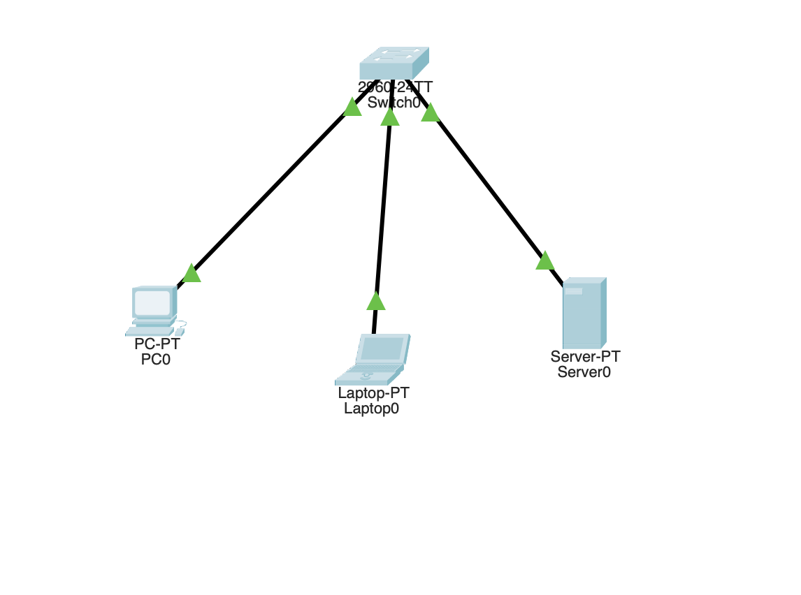
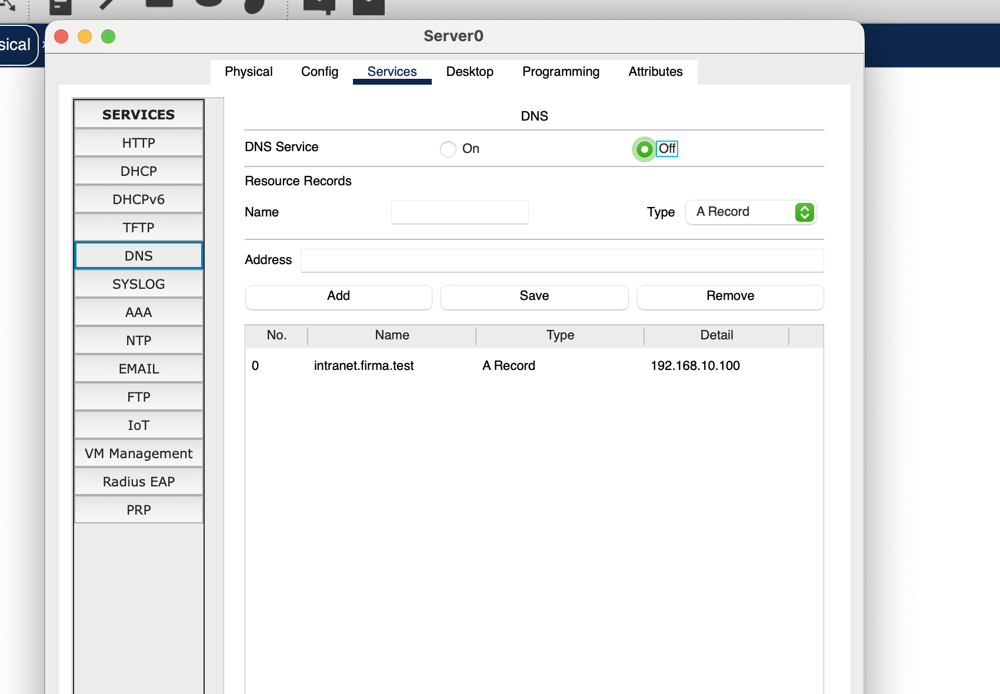
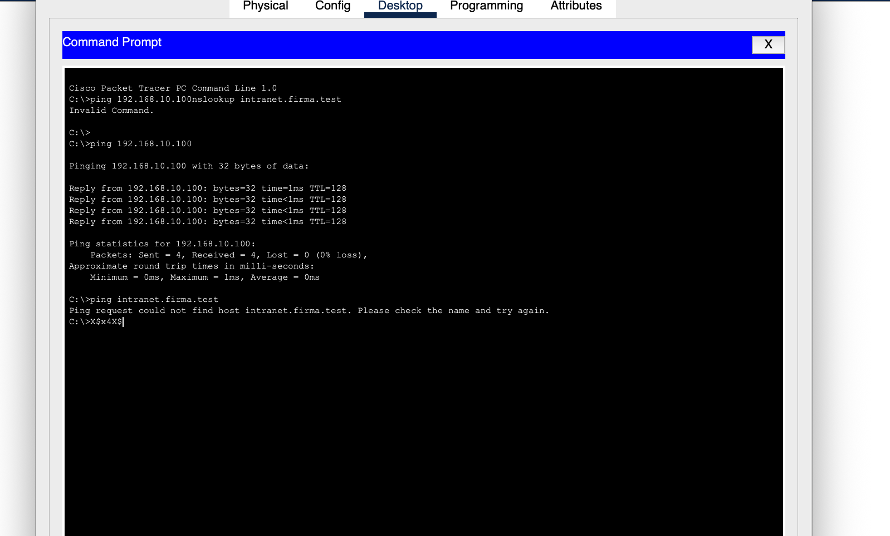
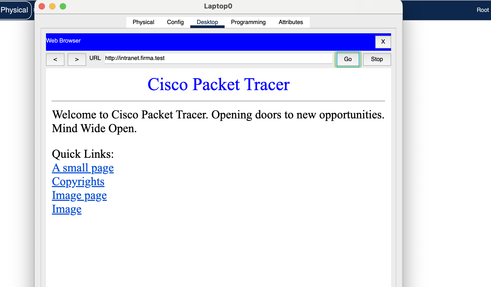

# Fallstudie 02 – Fehlerdiagnose bei einer internen Webseite (DNS)

**Bereich:** IT-Support / Netzwerktechnik  
**Software:** Cisco Packet Tracer  
**Projektart:** Selbst durchgeführte Trainingssimulation, keine reale Kundenstörung  
**Ergebnis:** Fehlerbild reproduziert; Erreichbarkeit der Webseite in einem späteren Screenshot dokumentiert

## 1. Ausgangssituation

In einem simulierten Unternehmensnetzwerk kann ein Client die interne Webseite `http://intranet.firma.test` nicht über den Domainnamen erreichen. Zu untersuchen ist, ob die Störung durch die Netzwerkverbindung, die Namensauflösung oder den Webserver verursacht wird.

Die Fehlersimulation besteht darin, den DNS-Dienst auf dem Server gezielt zu deaktivieren, während der passende A-Eintrag erhalten bleibt.

## 2. Netzwerkaufbau

| Gerät | IPv4-Konfiguration | Aufgabe |
|---|---|---|
| Laptop0 | `192.168.10.20/24` | Testclient; DNS-Server: `192.168.10.100` |
| PC0 | `192.168.10.10/24` | Zweiter Client |
| Server0 | `192.168.10.100/24` | DNS- und HTTP-Server |
| Switch0 | Cisco 2960-24TT | Verbindung innerhalb eines lokalen Netzes |

Es wird kein Router benötigt, weil die beteiligten Geräte im gleichen IPv4-Subnetz liegen. Der DNS-A-Eintrag lautet:

`intranet.firma.test` → `192.168.10.100`



*Abbildung 1: Netzwerkaufbau im Logical Workspace von Packet Tracer.*

## 3. Fehlersimulation

Auf **Server0 → Services → DNS** wurde der **DNS Service auf Off** gesetzt. Der A-Eintrag für `intranet.firma.test` blieb weiterhin in der Tabelle sichtbar.



*Abbildung 2: Der DNS-Dienst ist deaktiviert, der Ressourceneintrag ist weiterhin gespeichert.*

## 4. Diagnose

### 4.1 IP-Konnektivität prüfen

Zuerst habe ich geprüft, ob der Client den Server über seine IP-Adresse erreichen kann:

```text
C:\>ping 192.168.10.100
Packets: Sent = 4, Received = 4, Lost = 0 (0% loss)
```

**Beobachtung:** Vier ICMP-Antworten wurden empfangen. Der Server war also im Test **über die IP-Adresse mit ICMP erreichbar**.

**Interpretation:** Die grundlegende IP-Konnektivität funktionierte. Daraus folgt noch nicht, dass die DNS- oder HTTP-Anwendung erreichbar ist.

### 4.2 Namensauflösung prüfen

Anschließend habe ich den Domainnamen getestet:

```text
C:\>ping intranet.firma.test
Ping request could not find host intranet.firma.test.
Please check the name and try again.
```

**Beobachtung:** Der Client konnte den Namen nicht in eine IP-Adresse auflösen. Dies passt zum deaktivierten DNS-Dienst.



*Abbildung 3: Der IP-Ping ist erfolgreich, die Namensauflösung schlägt fehl.*

**Hinweis zur Beweiskraft:** In der Aufnahme ist außerdem ein ungültiger Befehl sichtbar, bei dem `ping` und `nslookup` versehentlich zusammen eingegeben wurden. **Es gibt daher keinen gültigen `nslookup`-Test in dieser Dokumentation.** Die Diagnose basiert auf den anschließend korrekt ausgeführten `ping`-Befehlen und auf der DNS-Konfiguration.

## 5. Ursache und Korrektur

**Identifizierte Ursache der Laborsimulation:** Der DNS-Dienst auf Server0 war deaktiviert. Deshalb konnte Laptop0 den Namen `intranet.firma.test` nicht wie vorgesehen auflösen, obwohl der Server unter seiner IP-Adresse antwortete.

**Korrekturmaßnahme:** Den DNS-Dienst auf Server0 unter **Services → DNS → On** wieder aktivieren und prüfen, ob der A-Eintrag auf `192.168.10.100` zeigt.

Ein späterer Screenshot zeigt, dass die interne Webseite über den Domainnamen erfolgreich aufgerufen werden konnte:



*Abbildung 4: Erfolgreicher Webseitenaufruf mit `http://intranet.firma.test`.*

**Einschränkung:** Der Browser-Screenshot zeigt einen funktionierenden Zugriff, aber **nicht unmittelbar die erneut aktivierte DNS-Einstellung**. Für eine vollständig reproduzierbare Vorher-nachher-Dokumentation sollte zusätzlich ein Screenshot von **DNS Service: On** und möglichst ein erfolgreicher Hostnamen-Ping nach der Korrektur ergänzt werden.

## 6. Erkenntnisse

- **IP-Konnektivität und DNS-Namensauflösung sind verschiedene Funktionen.**
- Mit `ping 192.168.10.100` lässt sich ICMP-Erreichbarkeit prüfen; dadurch wird die Funktion des DNS-Dienstes nicht bewiesen.
- Schlägt `ping intranet.firma.test` bereits bei der Namensauflösung fehl, sollte unter anderem die DNS-Serveradresse des Clients sowie der DNS-Dienst und seine Einträge überprüft werden.
- Ein strukturierter Vergleich der Testergebnisse ist hilfreicher als das wahllose Verändern von Einstellungen.

## 7. Projektdateien

Dieses Verzeichnis enthält die vier Original-Screenshots des Packet-Tracer-Labors. Die eigentlichen `.pkt`-Dateien sind **nicht enthalten**, da sie hier noch nicht bereitgestellt wurden. Bei einer späteren Ergänzung bieten sich an:

- `02-DNS-Failure.pkt` (DNS-Dienst deaktiviert)
- `02-DNS-Recovered.pkt` (DNS-Dienst aktiviert)

---

*Dokumentation einer persönlichen Übung mit Cisco Packet Tracer. Die Ergebnisse stammen aus einer kontrollierten Simulation und beschreiben keine produktive Firmenumgebung.*
